# Congestion Tax

* [Overview](#overview)
    - [Business rules](#business-rules)
    - [Flow](#flow)
    - [Use cases](#use-cases)
    - [Queries](#queries)
    - [Health checks](#health-checks)
* [Installation](#installation)
    - [Repository](#repository)
    - [Configuration](#configuration)
    - [Tests](#tests)
    - [Review](#review)
    - [Reports](#reports)
* [Environment setup](#environment-setup)
    - [Access URLs](#access-urls)
    - [Environment variables](#environment-variables)
* [License](#license)

## Overview

Implementation of the [Taxa de congestionamento][challenge] challenge from the backend-br repository. A city charges a
congestion tax on the vehicles that pass its tolling stations at fixed hours. Given a city, a vehicle type, and the
local dates and times of its passages, in any order, the service answers the tax the vehicle owes on each day and in
total.

[challenge]: https://github.com/backend-br/desafios/blob/main/congestion-tax/PROBLEM.md

Each city keeps its own rules as content, organized in tax periods. A period is in force between two dates, both
included, and carries the tariff, the daily maximum, the single charge window, the toll-free calendar, and the exempt
vehicles, so a new tariff or a new year of holidays is a new period. The service ships with the rules of Gothenburg for
2013, and `GET /tax-rules/gothenburg` answers them in full.

The HTTP contract is published in `openapi.yaml` at the repository root and detailed in the documentation pages linked
below. To exercise it, import the [Postman collection](docs/postman/congestion-tax.postman_collection.json). It covers
every operation, and running it top to bottom against the service started by `make start` calculates the tax of the
example of the challenge. It carries its own `baseUrl`, `http://congestion-tax.localhost:8380`, so it needs no
environment import.

### Business rules

The passages are grouped by local day, and each day is first checked against the tax period in force on it, in the
order of Figure 1.

<p align="center">
  
  <br>
  <sub>Figure 1. Does a day owe anything? The checks of a local day of passages in Gothenburg, 2013.</sub>
</p>

A day that owes something is priced passage by passage. Each passage takes the fee of the tariff band its local time
falls in, and a free passage is left out. A single charge window is anchored on the charged passage that opens it,
covers every charged passage up to 60 minutes after it, inclusive, and charges only the highest fee among them. It
never slides along with later passages, so the first charged passage after it opens the next one. The day owes the sum
of its windows, capped at the daily maximum. Figure 2 prices the second day of the example of the challenge.

<p align="center">
  
  <br>
  <sub>Figure 2. A charged day in Gothenburg, 2013-02-08. Pins are passages, hollow when free.</sub>
</p>

Over the whole example of the challenge, the car owes SEK 89: SEK 21 on 2013-02-07, the SEK 60 of Figure 2 on
2013-02-08, SEK 8 on 2013-03-26, and nothing on the toll-free days.

Sources: [congestion-tax-owes-anything.html](docs/diagrams/congestion-tax-owes-anything.html),
[congestion-tax-charged-day.html](docs/diagrams/congestion-tax-charged-day.html).

### Flow

<p align="center">
  
  <br>
  <sub>Figure 3. Communication of the Congestion Tax service.</sub>
</p>

Sources: [congestion-tax-flow.html](docs/diagrams/congestion-tax-flow.html).

### Use cases

- [Congestion tax calculating](docs/USE_CASES.md#congestion-tax-calculating)

### Queries

- [Find tax rules by city](docs/QUERIES.md#find-tax-rules-by-city)

### Health checks

- [Liveness check](docs/HEALTH.md#liveness-check)
- [Readiness check](docs/HEALTH.md#readiness-check)

## Installation

### Repository

To clone the repository using the command line, run:

```bash
git clone https://github.com/gustavofreze/congestion-tax.git
```

### Configuration

To install project dependencies locally, run:

```bash
make configure
```

To update dependencies to their latest compatible release, run:

```bash
make configure-and-update
```

To start the application containers, run:

```bash
make start
```

To stop the application containers and drop the data volume, run:

```bash
make stop
```

### Tests

Run all tests with coverage and mutation testing:

```bash
make tests
```

Run a specific test file without coverage:

```bash
make test-file FILE=tax_rules
```

### Review

Run static code analysis:

```bash
make review
```

Fix what static code analysis can correct:

```bash
make fix-review
```

### Reports

Open coverage and mutation reports in the browser:

```bash
make show-reports
```

Show outdated dependencies:

```bash
make show-outdated
```

> You can check other available commands by running `make help`.

## Environment setup

### Access URLs

| Environment | DNS                                  |
|:------------|:-------------------------------------|
| `Local`     | http://congestion-tax.localhost:8380 |

### Environment variables

Every variable the application, its database, and its migration run read. This is a proof of concept, so `.env.local` is
committed at the repository root and the `Development value` column below is the literal content of that file. Every
value in it is a local-only default and never a real credential. A deployed environment supplies its own values through
the container environment instead. The `Makefile` hands the file to Docker Compose with `--env-file`, and both the
`congestion-tax` and the `congestion-tax-migrate` services load it through `env_file`.

| Variable                           | Description                                                                                   | Development value                                              |
|:-----------------------------------|:----------------------------------------------------------------------------------------------|:---------------------------------------------------------------|
| `HTTP_ADDRESS`                     | Address and port the HTTP server binds to inside the container, published on the host as 8380 | `0.0.0.0:8080`                                                 |
| `TAX_RULES_CACHE_TTL_SECONDS`      | Seconds the tax rules of a city stay in memory once read                                      | `30`                                                           |
| `DATABASE_HOST`                    | Database host (docker service name)                                                           | `congestion-tax-adm`                                           |
| `DATABASE_PORT`                    | Database port inside the compose network, published on the host as 5480                       | `5432`                                                         |
| `DATABASE_NAME`                    | Database name                                                                                 | `congestion_tax_adm`                                           |
| `DATABASE_USER`                    | Least-privilege user the application reads the tax rules as                                   | `congestion_tax_app_user`                                      |
| `DATABASE_PASSWORD`                | Password of the application user                                                              | `congestion_tax_app_password`                                  |
| `DATABASE_INITDB_ARGS`             | Arguments the database container passes to `initdb` on first start, requiring passwords        | `--auth-local=scram-sha-256 --auth-host=scram-sha-256`         |
| `FLYWAY_URL`                       | JDBC URL the migration run connects to                                                        | `jdbc:postgresql://congestion-tax-adm:5432/congestion_tax_adm` |
| `FLYWAY_USER`                      | Database owner the migration run connects as                                                  | `postgres`                                                     |
| `FLYWAY_TABLE`                     | Table Flyway keeps its schema history in                                                      | `schema_history`                                               |
| `FLYWAY_PASSWORD`                  | Password of the database owner                                                                | `postgres`                                                     |
| `FLYWAY_LOCATIONS`                 | Directory the migration files are read from                                                   | `filesystem:/flyway/sql`                                       |
| `FLYWAY_CLEAN_DISABLED`            | Blocks `flyway clean` from dropping the schema                                                | `true`                                                         |
| `FLYWAY_VALIDATE_MIGRATION_NAMING` | Fails the migration run when a file name breaks the Flyway convention                         | `true`                                                         |

## License

Congestion Tax is licensed under [MIT](LICENSE).
